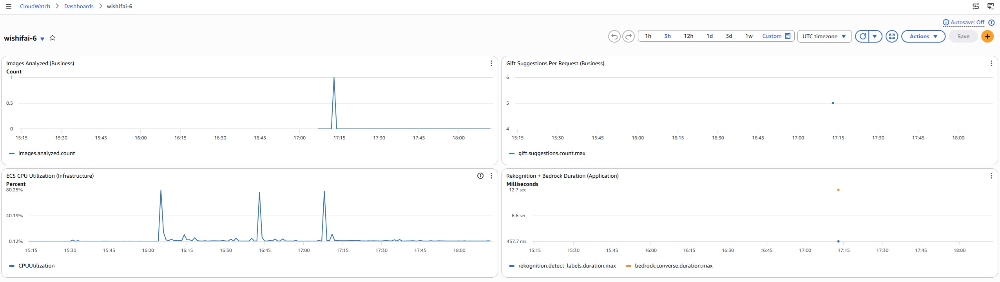

# Besvarelse

## Oppgave 1

### 1A

Først må et image bygges, jeg gir det taggen wishifai.

```
docker build -t wishifai .
```

Etter at imaget har blitt bygget så kan man starte en container med denne kommandoen.

```
docker run -p 9999:8080 wishifai
```

### 1B

Lenke til grønn kjøring: https://github.com/taffolds/eksamen-2026/actions/runs/41208422393

Commit-SHA har blitt brukt som tagging strategi. Dette er fordi det er statistisk veldig usannsynlig at to filer lager samme SHA, selv en liten endring i filen vil skape en helt annerledes SHA. Jeg har valgt å bruke --short da det fortsatt er svært usannsynlig at de første syv hexadecimale tallene blir like. Dette gjør at hver endring blir lett å spore fra image til en spesifikk GitHub commit.

## Oppgave 2

### 2A

Jeg har bestemt meg for separere ut IAM roller i en separat fil iam.tf for at main.tf skal inneholde mindre kode.
Offentlig URL til tjenesten: https://wi-85046072fab9462c8d3542d3075ff0e0.ecs.eu-west-1.on.aws

### 2B

Jeg har valgt å bruke mitt eget kandidatnummer som nøkkel. Dette kan bli sett på som en egen filsti inne i pgr301-terraform-state bucketen, slik at man unngår å skrive filer til andres directories. Jeg har på use_lockfile = true slik at kun en prosess kan bruke den av gangen. Dette gjør at man slipper å korrupte terraform.tfstate filen, og at man ikke får race conditions hvor to forskjellige pipeline-kjøringer kan få konflikt over hvordan staten skal være.

### 2C

Terraform kjører etter container-build, da den avhenger av at imaget faktisk eksisterer i registry til ECR. Hvis den ikke hadde gjort det, så hadde potensielt terraform laget container av feil image, avhengig av når de to jobbene ble ferdige.

Lenke til grønn kjøring: https://github.com/taffolds/eksamen-2026/actions/runs/41438374582

## Oppgave 3

### 3A

Jeg har valgt å lage to businessmetrikker da jeg følte at det ga mer mening for applikasjonen. Jeg har valgt å lage en Counter for mengden bilder analysert. Dette gir innblikk i hvor mye tjenesten blir brukt. Jeg har valgt å ha counteren etter at Rekognition og Bedrock har blitt kalt slik at man får innsikt i hvor mange ganger analyse har skjedd, ikke bare hvor mange ganger endepunktet har blitt kalt.

Jeg har også valgt å bruke en DistributionSummary metrikk for å se hvor mange gaveforslag som blir sendt til til bruker. Det er interessant å vite om det alltid blir sendt tilbake 5 forslag, eller om det kanskje er mindre noen ganger. Jeg kommer også til å bruke denne metrikken i 3B for å sjekke om servicen plutselig sender flere enn 5 forslag til tross for at prompten spesifiserer maks 5 forslag, sånn at man får varsel om at LLMen ikke utfører instruksjonene riktig.

### 3B

Dashboard heter "wishifai-6"



Jeg har valgt å ha metrikk for antall bilder som har blitt analysert, det kan være interessant å se hvor mye trafikk siden har fått totalt sett over en tidsperiode. Da kan man se om tjenesten er mer populær visse tider av døgnet. Jeg har også valgt å ha metrikk på ECS CPU bruk, for å kunne monitorere hvor mye CPU kraft containeren bruker. Dette kan hjelpe å se om den plutselig blir overbelastet.

De siste to metrikkene har jeg også koblet to forskjellige alarmer på. 
1. Jeg har sett i prompten at det kan være maks 5 gaveforslag. Det er greit å vite om LLMen begynner å gi for mange forslag da dette begynner å kaste bort tokens og koster penger. 
2. Jeg har også satt en alarm på hvor lang tid det tar for Rekognition og Bedrock å svare. Hvis de bruker over 10 sekunder, er dette greit å vite. Det betyr at servicene som wishifai er avhengig av er trege, og dermed blir også wishifai treg. Da kan man regne med at brukeropplevelsen er dårlig, og brukere vil tenke at tjenesten ikke fungerer så bra.

## Oppgave 4

Under testing av Wishifai sendte jeg et blankt hvitt bilde til tjenesten. I stedet for å returnere en feil eller indikere at bildet ikke inneholdt meningsfull informasjon, hallusinerte modellen at det kanskje var bestikk, og begynte å foreslå kjøkkengaver. Applikasjonen returnerte HTTP 200, og alle metrikker så normale ut. Fra et teknisk ståsted fungerte alt som det skulle og ingenting i overvåkningssystemet i oppgave 3 ville ha fanget opp dette.

Dette er noe modeller kan slite med, og her kunne man for eksempel gjort en sentiment analyse på responsen for å prøve å avdekke usikkerhet i svaret. LLMen var usikker, men svarte fortsatt som om det var et bilde av noe meningsfullt. Hvis man begynner å lage metrikker på hvor mange responser som inneholder usikkerhet, og begynner å ha stikkprøver på disse svarene, kan man kanskje avdekke svakheter i servicen.

Jeg har inkludert en alarm for drift i output for å se om LLMen begynner å returnere mer enn 5 forslag. Det var flere komponenter til prompten i BedrockService.java. Man kunne valgt ut flere av disse og satt på monitorering og alarmer for å se om det faktisk stemte overens med det man mente som utvikler. Vi mennesker kan ha et veldig tydelig bilde av noe i hodet, og kommunikasjon gjennom ord kan bli tvetydig. Metrikker som måler det du mener gir en mer matematisk og realistisk forståelse for det som faktisk skjer bak kulissene.

I Wishifai så er ikke disse problemene så store, og det kan være akseptabelt å oppdage feil i produksjon gjennom overvåkning og brukertilbakemeldinger. Men hvis man prøver å avdekke om et bilde viser hudkreft, så er det mye viktigere at treffsikkerheten er høy og at modellene ikke hallusinerer. Dette kan løses med flere pre-prod gates, som å gjennomføre tester med data for å se om bilder fra et dataset gir korrekte diagnoser. Å undersøke dette før produksjon kan være forskjellen på liv og død. Man kan også se for seg en bank som gir råd om hva kunder bør investere i. Her kan man også ha datasett hvor man kommer med input som emulerer kunders behov, og ha ekte investorer se over resultatet og se om de er enige i det. Her er det kanskje ikke liv på spill, men kunder blir ikke fornøyde hvis rådet fra banken fører til økonomiske tap. Jo høyere konsekvensene er, desto mer må kvalitetssikringen skje før produksjon, fremfor å stole på overvåkning i etterkant.